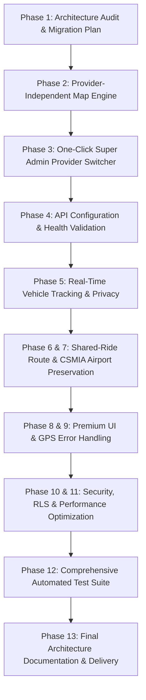

# AEROPOOL — DUAL MAP PROVIDER MIGRATION PLAN
## Phase 1 Deliverable: Step-by-Step Architecture, Implementation & Verification Roadmap

**Document:** `MAP_PROVIDER_MIGRATION_PLAN.md`  
**Target:** AeroPool Dual Map Provider Engine (Google Maps + Mapbox)  
**Safety Protocol:** Strict Zero-Disruption & Atomic Safe-Switching Policy  
**Environment:** Staging (`rkuzkwggijthbqwlwnps`) | Baseline Protected (`krxkxhieyqcytknixqdm`)

---

## 1. Migration Overview & Strategic Objectives

The objective is to upgrade AeroPool's mapping layer into a provider-independent architecture supporting **Google Maps** and **Mapbox** with **one-click switching** from the Super Admin dashboard.

### Core Architecture Goals:
1. **Zero Business Logic Disruption:** No changes to passenger booking, driver onboarding, KYC, ride matching, dispatch cascading, or payments.
2. **Atomic Safe Switching:** When switching from Google Maps to Mapbox (or vice-versa), the current provider remains active until the replacement provider passes initialization, connectivity, and rendering checks. If initialization fails, the platform rolls back cleanly without blank screens.
3. **State Preservation:** Camera center, zoom level, airport pickup zones, destination pins, verified routes, and authentic vehicle markers are seamlessly transferred across provider switches.
4. **Strict Real-Data Adherence:** Zero fake drivers, zero simulated coordinates, zero phantom availability. Real GPS and Phase 4 driver eligibility rules remain the single source of truth.
5. **Dark Midnight Premium Aesthetic:** Both providers render in AeroPool's signature midnight navy styling (`#0b1329`, `#1d2c4d`, `#38bdf8`) with custom vehicle rotation icons and airport lounge markers.

---

## 2. Implementation Sequence & Phase Roadmap



### Phase Breakdown:

### Phase 2: Provider-Independent Map Engine
- **Directory:** `src/services/maps/` and `src/components/maps/`
- **Interfaces to Define (`MapProvider.ts`):**
  - `MapProviderType`: `'google' | 'mapbox'`
  - `MapCameraState`: `{ center: { lat: number; lng: number }; zoom: number; heading?: number; pitch?: number }`
  - `MapMarkerDescriptor`: `{ id: string; position: { lat: number; lng: number }; title?: string; type: 'PICKUP' | 'DESTINATION' | 'VEHICLE'; heading?: number; vehiclePlate?: string; iconColor?: string; onClick?: () => void }`
  - `MapRouteDescriptor`: `{ polyline: { lat: number; lng: number }[]; strokeColor?: string; strokeWidth?: number }`
  - `IMapProvider`:
    - `initialize(container: HTMLElement, initialCamera: MapCameraState): Promise<void>`
    - `setCamera(camera: MapCameraState, animate?: boolean): void`
    - `getCamera(): MapCameraState`
    - `setMarkers(markers: MapMarkerDescriptor[]): void`
    - `setRoute(route: MapRouteDescriptor | null): void`
    - `setMapType(type: 'roadmap' | 'satellite'): void`
    - `onMapClick(listener: (pos: { lat: number; lng: number }) => void): () => void`
    - `fitBounds(bounds: { north: number; south: number; east: number; west: number }): void`
    - `destroy(): void`
- **Concrete Provider Implementations:**
  - `GoogleMapsProvider.ts`: Wraps `window.google.maps.Map`, `Marker`, `Polyline`, `DirectionsService`.
  - `MapboxProvider.ts`: Dynamically loads Mapbox GL JS and CSS, wraps `mapboxgl.Map`, `Marker`, GeoJSON route sources, and layers.
- **Factory:**
  - `MapProviderFactory.ts`: Resolves active provider based on system setting.

### Phase 3: One-Click Super Admin Provider Switcher
- **State Store (`src/services/maps/MapProviderConfig.ts`):**
  - Stores `activeProvider: 'google' | 'mapbox'`.
  - Backed by reactive subscription and persistent local storage / admin settings.
- **Safe Switching Flow:**
  1. Super Admin clicks "Switch to Mapbox" (or "Switch to Google Maps").
  2. Switcher initiates pre-flight health probe for the target provider.
  3. Pre-flight check confirms token/key format and API endpoint accessibility.
  4. If pre-flight fails: switch is aborted, active provider remains unchanged, and an error notification is displayed.
  5. If pre-flight passes: capture current camera coordinates, zoom, markers, and route.
  6. Instantiate new provider in a hidden staging container.
  7. On successful render event, atomically swap the visible DOM container.
  8. Restore camera, markers, route, and click listeners.
  9. Dispose and clean up previous provider instance.
  10. Update persistent `activeProvider` setting.
- **Admin Dashboard Integration (`src/views/AdminDashboardView.tsx`):**
  - Add dedicated "Map Provider Settings" section under Operations / Settings.
  - Interactive cards for Google Maps and Mapbox showing:
    - Provider Logo & Name
    - Active / Inactive Badge
    - API Key / Token Status (Masked)
    - Health Status: Search, Routing, Map Rendering
    - One-Click Switch Button with atomic rollback safety.

### Phase 4: API Configuration & Provider Health
- **Probing Engine (`src/services/maps/MapProviderHealth.ts`):**
  - Probes Google Maps Maps JS SDK, Places API, Routes/Directions API.
  - Probes Mapbox access token, Geocoding API (`api.mapbox.com/geocoding/v5/`), Directions API (`api.mapbox.com/directions/v5/`).
  - Measures live round-trip latency in milliseconds.
  - Detects quota errors, unauthorized domain restrictions, or billing review states.
- **Diagnostics Integration (`src/services/diagnosticsService.ts`):**
  - Upgrade `probeMapRoutingProvider()` to evaluate both Google Maps and Mapbox live health.

### Phase 5: Real-Time Vehicle Tracking & Privacy
- **Reactivity Bridge:**
  - Subscribes to `db.subscribe()` and Supabase Realtime channel.
  - Queries `db.findEligibleDriversForPickup()` relative to selected pickup zone (5 km radius).
  - Displays nearby eligible vehicles with smooth marker bearing rotation (`heading`).
  - Honors the strict empty state: if zero eligible drivers are online, shows zero vehicles with no fabricated markers.
- **Privacy Enforcement:**
  - Before booking confirmation: nearby vehicles are visualized with privacy-preserving approximate locations.
  - After booking confirmation: only the assigned driver's live GPS is rendered.
  - When trip concludes (`COMPLETED` or `CANCELLED`): coordinates are immediately redacted per Phase 4 privacy rules.

### Phase 6 & 7: Shared-Ride Routing & Airport Hub Preservation
- **Airport Pickup Preservations:**
  - `pz-t2-p4-east`: CSMIA T2 Level P4, Pillar 5 lounge bay (`19.0972, 72.8752`).
  - `pz-t2-p7-pool`: CSMIA T2 Level P7 MLCP Shared Ride Hub (`19.0965, 72.8739`).
  - `pz-t1-arr-main`: CSMIA T1 Domestic Curbside (`19.0886, 72.8679`).
- **Shared Journey Visualization:**
  - Visualizes airport departure runway geometry, pickup hub pin, multi-stop passenger drop-off pins, and cyan expressway polyline.
  - Seamlessly renders whether Google Directions or Mapbox Directions computed the polyline.

### Phase 8 & 9: Premium UI & GPS Error Handling
- **Aesthetic Alignment:**
  - Midnight Navy dark map styles across both Google Maps and Mapbox.
  - Cyan route geometry (`#38bdf8`), white airport departure pins (`#ffffff`), emerald destination pins (`#10b981`), blue vehicle marker (`#0ea5e9`).
- **GPS Error Handling:**
  - Solves `"Location request timed out. Please try again."`:
    - First attempts high accuracy (`enableHighAccuracy: true`, 6s timeout).
    - If timeout occurs, automatically retries with standard accuracy (`enableHighAccuracy: false`, 10s timeout, cached location accepted).
    - If user denies permission, gracefully highlights manual destination autocomplete and airport lounge selector without blocking booking.

### Phase 10 & 11: Security, RLS & Performance Optimization
- **Security Check:**
  - API keys restricted to client domain; service role keys strictly excluded.
  - RLS policies verified on Supabase staging (`rkuzkwggijthbqwlwnps`).
- **Performance:**
  - Marker debouncing and animation frame throttling.
  - Safe disposal of Mapbox GL and Google Maps listeners on component unmount to prevent memory leaks.

### Phase 12: Automated Verification & Regression Testing
- **Test Suite Expansion (`src/tests/testSuite.ts`):**
  - Add Tests 87–95 covering:
    - Provider interface conformance for Google Maps and Mapbox.
    - Safe atomic switching and failure rollback.
    - Camera and marker state preservation across switches.
    - GPS vehicle rotation and freshness filtering in both providers.
    - Zero fake data compliance on map canvas.
  - Run `npm test`, `npm run lint`, and `npm run build`.

---

## 3. Atomic Safe-Switching State Transition Model

```
[ Active Provider: Google Maps ]
               │
               ▼ (Admin clicks "Switch to Mapbox")
[ Health Pre-flight: Probing Mapbox Token & Endpoints ]
   ├── FAILED ─────────► [ Display Error Alert ] ──► [ Remain on Google Maps ]
   │
   └── PASSED
         ▼
[ Capture Current Map State: Camera, Zoom, Bounds, Markers, Route ]
         ▼
[ Mount Mapbox GL in Memory / Staging Container ]
   ├── INITIALIZATION ERROR ──► [ Display Alert ] ──► [ Remain on Google Maps ]
   │
   └── RENDER SUCCESS
         ▼
[ Atomically Swap Visible Map Element ]
         ▼
[ Restore Markers & Polylines onto Mapbox Instance ]
         ▼
[ Dispose Google Maps Listeners & Containers ]
         ▼
[ Commit Setting: activeMapProvider = 'mapbox' ]
```

---

## 4. Execution Safety & Change Control Policy

1. **Baseline Project Isolation:**
   - Supabase baseline `krxkxhieyqcytknixqdm` must **NEVER** be touched, migrated, or connected to.
   - All tests and operations run strictly against staging `rkuzkwggijthbqwlwnps` and local memory stores.
2. **No Remote Migrations Without Approval:**
   - Any remote database migration or bucket modification requires explicit user confirmation.
3. **Razorpay Guard:**
   - Payment credentials must remain in `TEST MODE` (`rzp_test_*`). Never enable live credentials.

---

## 5. Review & Authorization Gate

With Phase 1 deliverables (`MAP_PROVIDER_EXISTING_ARCHITECTURE_AUDIT.md` and `MAP_PROVIDER_MIGRATION_PLAN.md`) created, we now report our complete audit findings to the user and request approval to proceed with **Phase 2 (Provider-Independent Map Engine)**.
