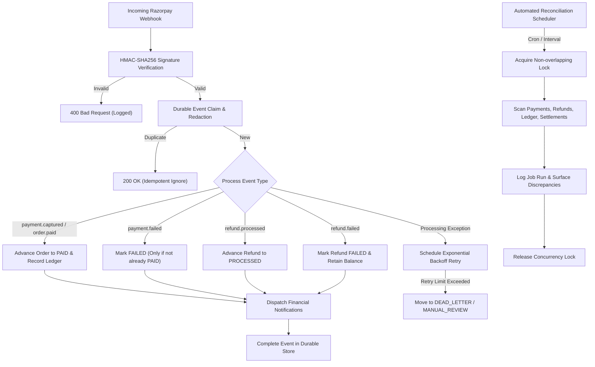

# AEROPOOL — PHASE 5E PRE-IMPLEMENTATION AUDIT
## Financial Notifications, Webhook Reliability & Automated Reconciliation

**Date:** November 3, 2026  
**Auditor:** Senior Fintech & Financial Reliability Architect  
**Operating Mode:** `sandbox`  
**Payment Gateway:** Razorpay TEST MODE (Strictly no live payments)  
**Database:** Supabase Staging (`rkuzkwggijthbqwlwnps.supabase.co`)  
**Protected Baseline:** Untouched (`krxkxhieyqcytknixqdm`)  

---

## 1. Audit Scope & Objectives

The purpose of Phase 5E is to harden AeroPool's financial operations into an observable, self-healing, and fault-tolerant financial engine. This audit examines:
1. Current Razorpay webhook ingestion, signature validation, and payload processing.
2. Webhook idempotency, event deduplication, and failure recovery pipelines (retry backoff, dead-letter, manual review).
3. Out-of-order event delivery handling and state machine race-condition guards.
4. User and administrative financial notification architecture.
5. Automated reconciliation scheduling, overlap locks, and execution logging.
6. Super Admin Financial Operations monitoring requirements.

---

## 2. Existing System Architecture Assessment

### 2.1 Webhook Ingestion & Idempotency Store (`server/idempotencyStore.ts` & `server/index.ts`)
- **Current State:**
  - `server/index.ts` mounts `express.raw({ type: 'application/json' })` on `/api/payments/webhook`.
  - Signature validation uses HMAC-SHA256 (`safeCompareSignatures`) against `RAZORPAY_WEBHOOK_SECRET`.
  - `IWebhookEventStore` provides `claimEvent`, `completeEvent`, and `failEvent`.
  - Implemented for both `SandboxWebhookEventStore` (in-memory `Map`) and `SupabaseWebhookEventStore` (backed by PostgreSQL `processed_webhook_events`).
- **Gaps Identified:**
  - **Limited Event Types:** Current route only processes `payment.captured`, `payment.failed`, `refund.processed`, `refund.failed`. Missing: `payment.authorized`, `refund.created`, `order.paid`.
  - **Out-of-Order Vulnerability:** An older event (e.g. `payment.failed` or delayed `payment.authorized`) arriving after `payment.captured` could overwrite the terminal `PAID` state if not guarded by monotonic state machine checks.
  - **No Retry or Dead-Letter Management:** If a webhook fails to process (e.g. temporary database lock), it is immediately marked `FAILED` with no exponential backoff retry scheduling, dead-letter escalation, or admin replay capability.
  - **Unredacted Payload Handling:** Sensitive customer details (masked cards, UPI VPA prefixes) are stored as raw JSON rather than scrubbed.

### 2.2 Financial Notification Infrastructure (`src/services/db.ts` & `src/types/index.ts`)
- **Current State:**
  - `db.createNotification()` supports in-app notifications with `eventId` deduplication to prevent spamming.
  - Supports categories: `FLIGHT`, `DISPATCH`, `TRIP`, `SETTLEMENT`, `SYSTEM`.
- **Gaps Identified:**
  - Missing dedicated `PAYMENT`, `REFUND`, and `RECONCILIATION` notification categories.
  - No server-side or database-driven notification dispatch for payment confirmations, refund status transitions, driver earnings credits, or critical reconciliation discrepancies.
  - Notification ownership and role isolation need explicit enforcement so passengers cannot view peer financial records.
  - External channels (email/SMS/push) are not configured in this sandbox environment; internal notifications must record delivery limitations transparently.

### 2.3 Financial Reconciliation & Scheduler (`server/orderStore.ts` & `src/services/db.ts`)
- **Current State:**
  - Phase 5D introduced `runReconciliationAudit()` (server) and `runLocalReconciliationAudit()` (client), which scan for orphan captures, duplicate provider references, refund overruns, and unverified settlement payouts.
- **Gaps Identified:**
  - **Manual Only:** Reconciliation runs only on demand when triggered via admin UI or API.
  - **No Background Cron / Job Manager:** No scheduled job runner in `server/` with configurable frequency, execution history, records scanned metrics, and duration tracking.
  - **Missing Concurrency Lock:** Two concurrent reconciliation runs could evaluate the same state simultaneously, leading to duplicated discrepancy alerts.
  - **Missing Driver Ledger Cross-Checks:** Does not currently audit completed trips for missing driver earnings ledger entries or driver payable mismatches against fleet settlement totals.

### 2.4 Super Admin Command Center (`src/components/AdminFinancialCommandCenter.tsx`)
- **Current State:**
  - Displays 7 sub-tabs: `Overview`, `Transactions`, `Refunds`, `Settlements`, `Policies`, `Reconciliation`, `Exports`.
- **Gaps Identified:**
  - Missing a dedicated **Financial Operations & Monitoring** section (`monitoring` tab) displaying webhook processing health, failed webhooks count, pending retry queue, dead-letter items, and recent scheduled reconciliation job history.
  - Missing admin action buttons to replay/retry eligible failed webhooks and move non-retryable items to manual review.

---

## 3. Mandatory Safety Rules & Invariants

1. **Operating Mode:** Strictly preserve `VITE_OPERATING_MODE="sandbox"`.
2. **Payment Mode:** Razorpay TEST MODE only. Live transactions, real UPI handles, and actual bank disbursements are strictly forbidden.
3. **Database Guardrails:**
   - Active Staging DB: `rkuzkwggijthbqwlwnps.supabase.co`.
   - Baseline DB: Untouched (`krxkxhieyqcytknixqdm`).
   - Remote migrations: Strictly forbidden. Only local SQL migration files will be created in `supabase/migrations/`.
4. **Data Integrity:** Zero fake stats or synthesized mock balances. Clean empty states when records are absent.
5. **Monotonic State Transitions:** Webhook processing must obey forward-only state progression:
   $$\text{CREATED} \longrightarrow \text{AUTHORIZED} \longrightarrow \text{PAID} \longrightarrow (\text{PARTIALLY\_REFUNDED} \mid \text{REFUNDED})$$
   A delayed or out-of-order `payment.failed` or `payment.authorized` event must **never** downgrade a `PAID` order.

---

## 4. Phase 5E Implementation Plan

---

## 5. Audit Sign-off

The system baseline is stable with 170 passing tests. Phase 5E will now proceed with:
1. Webhook reliability and out-of-order state guards.
2. Exponential backoff retry queue and dead-letter review.
3. Centralized financial notification engine.
4. Automated background reconciliation scheduler with overlap lock.
5. Financial Operations & Monitoring tab in Super Admin Command Center.
6. Automated Tests 171–185+.

