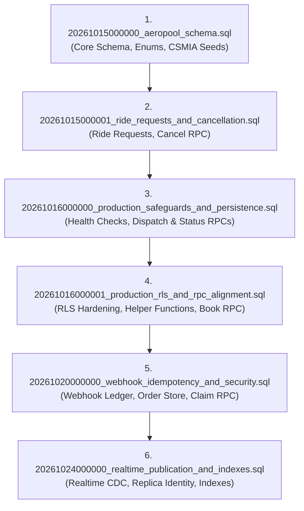

# AeroPool — Supabase Migration Security Review (Read-Only)

**Document Version:** 1.0.0  
**Audit Date:** October 24, 2026  
**Auditor:** Antigravity Senior Full-Stack & Database Security Agent  
**Review Type:** Static Code Analysis & Security Audit of SQL Migrations (Strict Read-Only)  
**Target Environment:** Supabase PostgreSQL 15+ (`krxkxhieyqcytknixqdm.supabase.co`)  
**Status:** **READ-ONLY REVIEW COMPLETE — ZERO HOSTED CHANGES EXECUTED**

---

## 1. Executive Summary & Risk Rating

### 1.1 Executive Summary
A comprehensive security and architectural audit was conducted across all six SQL migration scripts in `supabase/migrations/`, cross-referenced against the AeroPool application query layer (`src/services/db.ts`, `server/idempotencyStore.ts`, `server/orderStore.ts`, and `scripts/verifySupabase.ts`).

The migrations provide a solid foundation: tables utilize appropriate relational foreign keys, atomic RPCs utilize `FOR UPDATE` row-level locking to avoid capacity race conditions, idempotency keys prevent duplicate reservations, financial safeguards prevent mock `pay_BOM_*` IDs from being recorded in production, and server-side webhook tables are isolated to the `service_role`.

However, the audit identified **two critical authorization vulnerabilities**, **three high-severity multi-tenant and permission flaws**, and several schema-application misalignments that **must be corrected prior to deploying to the hosted Supabase database**.

### 1.2 Overall Migration Risk Rating
**OVERALL RISK RATING: HIGH (DO NOT DEPLOY WITHOUT FIXES)**

| Severity Level | Count | Summary of Key Concerns |
| :--- | :---: | :--- |
| **CRITICAL** | **2** | • RPC Authorization Bypass in `cancel_booking_atomic` (allows cancelling any booking)<br/>• Unauthenticated / Unverified caller parameter in `book_ride_atomic` (`p_passenger_id` spoofing) |
| **HIGH** | **4** | • Unenforced Row Level Security on `audit_logs` table (immutable audit trail exposed)<br/>• Missing caller authorization & tenant isolation in `assign_driver_to_pool_atomic`<br/>• Missing caller authorization in `advance_ride_status_atomic`<br/>• Missing RLS `INSERT` policy on `ride_pools` (blocks passenger ride pool creation in production) |
| **MEDIUM** | **4** | • Client-controlled fare parameter injection in `book_ride_atomic`<br/>• Broad `EXCEPTION WHEN others THEN null` swallowing migration errors<br/>• Missing RLS policies on `bookings` for support staff and fleet operators<br/>• Denormalized passenger metadata columns not populated by `book_ride_atomic` |
| **LOW / INFO** | **3** | • Application seed data uses slug strings (`org-metrocab-mumbai`) incompatible with PostgreSQL `UUID`<br/>• Realtime publication rerun logic relies on swallowed exceptions rather than catalog checks<br/>• Missing `INSERT` policy or auth trigger for automatic `profiles` creation on user signup |

---

## 2. Strict Safety Compliance Statement
In strict accordance with the security directive:
- **No migrations were applied.**
- `supabase db push` was **not executed**.
- No DDL or DML SQL statements were run against the hosted Supabase database.
- No hosted tables, schema, RLS policies, authentication configurations, or Realtime publications were altered.
- No credentials, API keys, service role tokens, or secrets have been printed, exposed, or committed.
- `.env` remained completely untouched.
- No SQL files in `supabase/migrations/` were modified in this review pass.

---

## 3. Migration-by-Migration Detailed Findings

### Migration 1: `20261015000000_aeropool_schema.sql`
*Initial core schema, enum definitions, base tables, CSMIA Mumbai seed data, initial `book_ride_atomic` RPC, and initial RLS.*

| Ref | Severity | File & Lines | Category | Finding & Impact |
| :--- | :---: | :--- | :--- | :--- |
| **M1-01** | **HIGH** | `supabase/migrations/20261015000000_aeropool_schema.sql`<br/>[Lines 239-250, 378-385](file:///c:/Users/praty/Aeropool%201/supabase/migrations/20261015000000_aeropool_schema.sql#L239-L250) | RLS Omission | **`audit_logs` table has NO Row Level Security enabled.**<br/>While RLS is enabled on 7 tables (lines 378-385), `audit_logs` is omitted. Because PostgREST exposes public tables by default, any client with anon/authenticated keys can query or alter audit logs unless RLS is enabled and policies are restricted. |
| **M1-02** | **MEDIUM** | `supabase/migrations/20261015000000_aeropool_schema.sql`<br/>[Lines 265-283](file:///c:/Users/praty/Aeropool%201/supabase/migrations/20261015000000_aeropool_schema.sql#L265-L283) | Security Definer | **`book_ride_atomic` (13-arg legacy) lacks `SET search_path = public`.**<br/>The original procedure runs as `SECURITY DEFINER` without setting `search_path`. This is vulnerable to search path hijacking. *(Partially mitigated in Migration 4 which drops and redefines this function with `SET search_path = public`, but unsafe if Migration 1 is run standalone).* |
| **M1-03** | **MEDIUM** | `supabase/migrations/20261015000000_aeropool_schema.sql`<br/>[Lines 400-420](file:///c:/Users/praty/Aeropool%201/supabase/migrations/20261015000000_aeropool_schema.sql#L400-L420) | RLS Recursion | **Initial RLS subquery recursion risk on `profiles`.**<br/>The initial policies on `vehicles` and `driver_profiles` perform subqueries against `profiles`. Since RLS is enabled on `profiles` without a policy defined in Migration 1, non-superuser queries on `vehicles` fail or trigger evaluation errors. *(Addressed in Migration 4 via `SECURITY DEFINER` helper functions).* |
| **M1-04** | **LOW** | `supabase/migrations/20261015000000_aeropool_schema.sql`<br/>[Lines 38, 51, 70, 85](file:///c:/Users/praty/Aeropool%201/supabase/migrations/20261015000000_aeropool_schema.sql#L38-L85) | Type Safety | **Foreign key dependencies on `auth.users(id)`.**<br/>The schema assumes execution inside a Supabase-managed PostgreSQL instance where `auth.users` exists. Running this script on a standard vanilla PostgreSQL database fails without an `auth` schema mock. |
| **M1-05** | **INFO** | `supabase/migrations/20261015000000_aeropool_schema.sql`<br/>[Lines 135-144](file:///c:/Users/praty/Aeropool%201/supabase/migrations/20261015000000_aeropool_schema.sql#L135-L144) | Idempotency | **Airport and pickup zone seed data is properly idempotent.**<br/>Uses `ON CONFLICT (id) DO NOTHING` for `BOM` airport and terminals `T1`/`T2` pickup bays. Safe for re-execution. |

---

### Migration 2: `20261015000001_ride_requests_and_cancellation.sql`
*Ride requests ledger, matching indexes, and `cancel_booking_atomic` RPC.*

| Ref | Severity | File & Lines | Category | Finding & Impact |
| :--- | :---: | :--- | :--- | :--- |
| **M2-01** | **CRITICAL** | `supabase/migrations/20261015000001_ride_requests_and_cancellation.sql`<br/>[Lines 82-87](file:///c:/Users/praty/Aeropool%201/supabase/migrations/20261015000001_ride_requests_and_cancellation.sql#L82-L87) | Broken Authorization | **CRITICAL AUTHORIZATION BYPASS IN `cancel_booking_atomic`:**<br/>```sql<br/>IF v_booking.passenger_id != p_passenger_id THEN<br/>  IF NOT EXISTS (SELECT 1 FROM profiles WHERE id = p_passenger_id AND role = 'admin') THEN<br/>    RETURN jsonb_build_object('success', false, 'error', 'Unauthorized: You can only cancel your own booking.');<br/>  END IF;<br/>END IF;<br/>```<br/>The procedure runs with `SECURITY DEFINER` and compares `v_booking.passenger_id` against the caller-supplied `p_passenger_id`. It **never validates against `auth.uid()`**.<br/>If an attacker supplies `p_passenger_id = v_booking.passenger_id`, the condition `v_booking.passenger_id != p_passenger_id` evaluates to `FALSE`, completely bypassing the authorization guard.<br/>**Impact:** Any user (or anonymous caller) can cancel any passenger's booking, release pool seats, and issue ledger refunds by guessing or extracting the target booking's passenger ID. |
| **M2-02** | **MEDIUM** | `supabase/migrations/20261015000001_ride_requests_and_cancellation.sql`<br/>[Lines 84, 134](file:///c:/Users/praty/Aeropool%201/supabase/migrations/20261015000001_ride_requests_and_cancellation.sql#L84-L134) | Role Restriction | **Support staff role cannot cancel bookings.**<br/>Line 84 specifically checks `role = 'admin'`. Customer support agents (`role = 'support'`) who receive customer calls are blocked from cancelling bookings via this RPC. In addition, the audit log insert (line 134) hardcodes `actor_role` to `'passenger'`. |
| **M2-03** | **INFO** | `supabase/migrations/20261015000001_ride_requests_and_cancellation.sql`<br/>[Lines 102-113](file:///c:/Users/praty/Aeropool%201/supabase/migrations/20261015000001_ride_requests_and_cancellation.sql#L102-L113) | Capacity Safety | **Atomic capacity restoration is mathematically bounded.**<br/>Uses `LEAST(total_seats, available_seats + v_released_seats)` under a row-level `FOR UPDATE` lock. Prevents seat capacity inflation beyond vehicle maximum. |

---

### Migration 3: `20261016000000_production_safeguards_and_persistence.sql`
*System health checks table, idempotency columns, financial integrity constraint, `assign_driver_to_pool_atomic` RPC, and `advance_ride_status_atomic` RPC.*

| Ref | Severity | File & Lines | Category | Finding & Impact |
| :--- | :---: | :--- | :--- | :--- |
| **M3-01** | **HIGH** | `supabase/migrations/20261016000000_production_safeguards_and_persistence.sql`<br/>[Lines 47-142](file:///c:/Users/praty/Aeropool%201/supabase/migrations/20261016000000_production_safeguards_and_persistence.sql#L47-L142) | Multi-Tenancy & Authorization | **No caller verification or tenant isolation in `assign_driver_to_pool_atomic`.**<br/>The function is `SECURITY DEFINER`. It accepts `p_actor_id UUID` as a plain argument without verifying that `auth.uid() = p_actor_id` or verifying that the caller has `admin`, `support`, or `fleet_operator` role.<br/>Crucially, it does **not check multi-tenant isolation**: it does not verify that `p_driver_id` and `p_vehicle_id` belong to the same fleet organization (`driver.organization_id = vehicle.organization_id`), nor does it check that a fleet operator is only assigning assets within their own tenant (`driver.organization_id = current_user_org_id()`). |
| **M3-02** | **HIGH** | `supabase/migrations/20261016000000_production_safeguards_and_persistence.sql`<br/>[Lines 145-226](file:///c:/Users/praty/Aeropool%201/supabase/migrations/20261016000000_production_safeguards_and_persistence.sql#L145-L226) | Authorization | **Missing caller verification in `advance_ride_status_atomic`.**<br/>The function validates state machine transitions (`REQUESTED` -> `CONFIRMED` -> `DRIVER_ASSIGNED` etc.) and locks rows with `FOR UPDATE`. However, it **does not verify caller identity**: it does not enforce that only the assigned driver (`v_pool.assigned_driver_id = auth.uid()`) or administrative staff (`public.is_admin_or_support()`) can advance ride statuses. A passenger or unassigned driver can transition a pool to `COMPLETED`. |
| **M3-03** | **MEDIUM** | `supabase/migrations/20261016000000_production_safeguards_and_persistence.sql`<br/>[Lines 23-32, 36-44](file:///c:/Users/praty/Aeropool%201/supabase/migrations/20261016000000_production_safeguards_and_persistence.sql#L23-L44) | Error Masking | **Broad `EXCEPTION WHEN others THEN null` masks DDL failures.**<br/>Alter table statements for `idempotency_key` and the payment constraint are wrapped in unconditional catch-all blocks. If an execution error occurs (such as a lock timeout or permissions failure), the error is swallowed and the migration reports success without applying the schema change. |
| **M3-04** | **INFO** | `supabase/migrations/20261016000000_production_safeguards_and_persistence.sql`<br/>[Lines 36-44](file:///c:/Users/praty/Aeropool%201/supabase/migrations/20261016000000_production_safeguards_and_persistence.sql#L36-L44) | Financial Integrity | **Production payment safeguard `check_production_payment_id` is robust.**<br/>Enforces that `operating_mode = 'production'` strictly rejects simulated sandbox payment IDs (`pay_BOM_%`). Excellent financial guardrail against sandbox leaks. |

---

### Migration 4: `20261016000001_production_rls_and_rpc_alignment.sql`
*Comprehensive RLS hardening across 13 tables, non-recursive security definer helper functions, storage column type alignments, and idempotent `book_ride_atomic` RPC.*

| Ref | Severity | File & Lines | Category | Finding & Impact |
| :--- | :---: | :--- | :--- | :--- |
| **M4-01** | **CRITICAL** | `supabase/migrations/20261016000001_production_rls_and_rpc_alignment.sql`<br/>[Lines 249-272, 360-376](file:///c:/Users/praty/Aeropool%201/supabase/migrations/20261016000001_production_rls_and_rpc_alignment.sql#L249-L376) | Broken Authorization | **Missing passenger caller check in `book_ride_atomic`:**<br/>The function runs as `SECURITY DEFINER`. It accepts `p_passenger_id UUID` as a parameter. It **never asserts `auth.uid() = p_passenger_id` or `public.is_admin()`**.<br/>**Impact:** Any authenticated user can invoke `supabase.rpc('book_ride_atomic', { p_passenger_id: '<victim_uuid>', ... })` and forge bookings registered under other passengers' accounts. |
| **M4-02** | **HIGH** | `supabase/migrations/20261016000001_production_rls_and_rpc_alignment.sql`<br/>[Lines 19-32](file:///c:/Users/praty/Aeropool%201/supabase/migrations/20261016000001_production_rls_and_rpc_alignment.sql#L19-L32) | RLS Omission | **`audit_logs` is still missing RLS.**<br/>Migration 4 enables RLS on 13 tables (lines 19-31) and re-creates policies. However, `audit_logs` is omitted from both `ALTER TABLE ... ENABLE ROW LEVEL SECURITY` and policy definitions. |
| **M4-03** | **HIGH** | `supabase/migrations/20261016000001_production_rls_and_rpc_alignment.sql`<br/>[Lines 200-211](file:///c:/Users/praty/Aeropool%201/supabase/migrations/20261016000001_production_rls_and_rpc_alignment.sql#L200-L211)<br/>`src/services/db.ts` [Lines 1508-1526](file:///c:/Users/praty/Aeropool%201/src/services/db.ts#L1508-L1526) | RLS Misalignment | **Missing `INSERT` policy on `ride_pools` blocks passenger pool requests.**<br/>`ride_pools` policies only permit SELECT for regular users and ALL for admins/dispatchers (`is_admin_or_support()`). When a passenger books a ride for a new corridor/time slot where no pool exists, `src/services/db.ts` executes `await supabase.from('ride_pools').insert(...)`. In production mode, this is rejected by RLS with a policy violation error. |
| **M4-04** | **HIGH** | `supabase/migrations/20261016000001_production_rls_and_rpc_alignment.sql`<br/>[Lines 260-261, 373, 385](file:///c:/Users/praty/Aeropool%201/supabase/migrations/20261016000001_production_rls_and_rpc_alignment.sql#L260-L385) | Financial Safety | **Client-supplied fare injection in `book_ride_atomic`.**<br/>`p_fare_paise INT` is passed directly from the browser client and inserted into `bookings` and `payments`. The database does not validate this amount against an authorized `payment_orders` entry or corridor pricing constraints. A malicious client could pass `p_fare_paise = 1` and record a confirmed booking for ₹0.01. |
| **M4-05** | **MEDIUM** | `supabase/migrations/20261016000001_production_rls_and_rpc_alignment.sql`<br/>[Lines 9-16, 360-376](file:///c:/Users/praty/Aeropool%201/supabase/migrations/20261016000001_production_rls_and_rpc_alignment.sql#L9-L376) | Schema Desync | **Denormalized passenger metadata columns remain NULL.**<br/>Columns `passenger_name` and `passenger_phone` are added to `bookings` (lines 9-10), but `book_ride_atomic` neither accepts nor inserts them into `bookings`. Because drivers cannot read passenger records from `profiles` under RLS, drivers will see NULL passenger names and contact numbers. |
| **M4-06** | **MEDIUM** | `supabase/migrations/20261016000001_production_rls_and_rpc_alignment.sql`<br/>[Lines 19-32, 91-242](file:///c:/Users/praty/Aeropool%201/supabase/migrations/20261016000001_production_rls_and_rpc_alignment.sql#L19-L242) | RLS Omission | **`bookings` policies were not refreshed in Migration 4.**<br/>Migration 4 left Migration 1's booking policies active. Under these policies, `support` staff cannot view `bookings` (only `admin`), and `fleet_operator` cannot view bookings associated with their fleet drivers/vehicles. |
| **M4-07** | **LOW** | `supabase/migrations/20261016000001_production_rls_and_rpc_alignment.sql`<br/>[Lines 92-111](file:///c:/Users/praty/Aeropool%201/supabase/migrations/20261016000001_production_rls_and_rpc_alignment.sql#L92-L111) | User Onboarding | **No `INSERT` policy or auth trigger on `profiles`.**<br/>When a new user signs up in Supabase Auth, client insertion into `profiles` will be rejected by RLS because only SELECT and UPDATE policies exist. A database trigger on `auth.users` (`AFTER INSERT`) is required. |
| **M4-08** | **INFO** | `supabase/migrations/20261016000001_production_rls_and_rpc_alignment.sql`<br/>[Lines 34-82](file:///c:/Users/praty/Aeropool%201/supabase/migrations/20261016000001_production_rls_and_rpc_alignment.sql#L34-L82) | Architecture Pattern | **RLS helper functions eliminate recursion.**<br/>`public.is_admin()`, `public.is_staff()`, `public.is_admin_or_support()`, and `public.current_user_org_id()` are properly defined as `SECURITY DEFINER` with `SET search_path = public`, cleanly avoiding infinite RLS loops when querying user roles. |

---

### Migration 5: `20261020000000_webhook_idempotency_and_security.sql`
*Durable webhook idempotency table (`processed_webhook_events`), authoritative payment orders table (`payment_orders`), service role RLS isolation, and `claim_webhook_event_atomic` RPC.*

| Ref | Severity | File & Lines | Category | Finding & Impact |
| :--- | :---: | :--- | :--- | :--- |
| **M5-01** | **HIGH** | `supabase/migrations/20261020000000_webhook_idempotency_and_security.sql`<br/>[Lines 77-142](file:///c:/Users/praty/Aeropool%201/supabase/migrations/20261020000000_webhook_idempotency_and_security.sql#L77-L142) | Function Privileges | **`claim_webhook_event_atomic` lacks explicit execution restrictions.**<br/>PostgreSQL grants `EXECUTE` on functions in `public` to `PUBLIC` by default. Any unauthenticated caller via PostgREST can execute `claim_webhook_event_atomic` with fabricated event IDs, poisoning the idempotency ledger and causing genuine Razorpay webhook events to be marked as duplicates. Needs explicit `REVOKE EXECUTE ... FROM PUBLIC, anon, authenticated` and `GRANT ... TO service_role`. |
| **M5-02** | **INFO** | `supabase/migrations/20261020000000_webhook_idempotency_and_security.sql`<br/>[Lines 48-75](file:///c:/Users/praty/Aeropool%201/supabase/migrations/20261020000000_webhook_idempotency_and_security.sql#L48-L75) | RLS Isolation | **`processed_webhook_events` and `payment_orders` RLS is well-isolated.**<br/>`processed_webhook_events` is restricted strictly to `service_role`. `payment_orders` isolates passengers to their own orders while granting full reconciliation access to `service_role`. |
| **M5-03** | **INFO** | `supabase/migrations/20261020000000_webhook_idempotency_and_security.sql`<br/>[Lines 129-140](file:///c:/Users/praty/Aeropool%201/supabase/migrations/20261020000000_webhook_idempotency_and_security.sql#L129-L140) | Concurrency Safety | **Unique violation handling in webhook claim is safe.**<br/>Catches `unique_violation` (PostgreSQL error 23505) and returns duplicate status rather than rolling back the entire database transaction. |

---

### Migration 6: `20261024000000_realtime_publication_and_indexes.sql`
*Realtime publication configuration, full replica identity, and high-frequency composite query indexes.*

| Ref | Severity | File & Lines | Category | Finding & Impact |
| :--- | :---: | :--- | :--- | :--- |
| **M6-01** | **MEDIUM** | `supabase/migrations/20261024000000_realtime_publication_and_indexes.sql`<br/>[Lines 15-21](file:///c:/Users/praty/Aeropool%201/supabase/migrations/20261024000000_realtime_publication_and_indexes.sql#L15-L21) | Error Masking | **Unconditional exception block on `ALTER PUBLICATION`.**<br/>Wrapping `ALTER PUBLICATION supabase_realtime ADD TABLE ...` in `EXCEPTION WHEN others THEN null` hides permission errors or publication misconfigurations. An idempotent catalog check against `pg_publication_tables` should be used instead. |
| **M6-02** | **LOW** | `supabase/migrations/20261024000000_realtime_publication_and_indexes.sql`<br/>[Lines 9-11](file:///c:/Users/praty/Aeropool%201/supabase/migrations/20261024000000_realtime_publication_and_indexes.sql#L9-L11) | Performance / WAL | **`REPLICA IDENTITY FULL` increases WAL write volume.**<br/>Enabling `REPLICA IDENTITY FULL` on `bookings`, `ride_pools`, and `driver_profiles` forces PostgreSQL to log complete pre-update row images on every update. While necessary for Supabase Realtime RLS filtering on updates, high-frequency updates to driver positions could lead to WAL bloat if driver GPS tracking is ever stored in `driver_profiles`. |
| **M6-03** | **INFO** | `supabase/migrations/20261024000000_realtime_publication_and_indexes.sql`<br/>[Lines 24-34](file:///c:/Users/praty/Aeropool%201/supabase/migrations/20261024000000_realtime_publication_and_indexes.sql#L24-L34) | Performance | **Composite indexes align with hot query paths.**<br/>Indexes `(pool_id, passenger_id)`, `(status, departure_window_start)`, `(organization_id, is_available)`, and `(booking_id, status)` directly match the application's polling and subscription query filters. |

---

## 4. Cross-Cutting Analysis

### 4.1 Tenant & Role Isolation Matrix
| Table | Passenger Role | Driver Role | Fleet Operator Role | Admin Role | Support Role |
| :--- | :--- | :--- | :--- | :--- | :--- |
| `profiles` | Own profile (SELECT, UPDATE) | Own profile (SELECT, UPDATE) | Own profile + Drivers in own org (SELECT) | Full Access | Full Access |
| `organizations` | None | None | Own organization only (SELECT) | Full Access | None *(Deficiency)* |
| `vehicles` | None | Assigned vehicle only (SELECT) | Own org vehicles (SELECT, INSERT, UPDATE, DELETE) | Full Access | None *(Deficiency)* |
| `driver_profiles` | None | Own profile only (SELECT) | Own org drivers (SELECT, INSERT, UPDATE, DELETE) | Full Access | Full Access |
| `driver_documents`| None | Own documents (ALL) | Own org drivers' documents (SELECT) | Full Access | Full Access |
| `ride_pools` | Active pools (SELECT) | Assigned pool (SELECT) | Active pools (SELECT) | Full Access | Full Access |
| `bookings` | Own bookings (SELECT) | Assigned pool bookings (SELECT) | None *(Deficiency)* | Full Access | None *(Deficiency)* |
| `payments` | Own payments (SELECT) | None | None | Full Access | Full Access |
| `safety_incidents`| Own reports (ALL) | Own reports (ALL) | None | Full Access | Full Access |
| `support_tickets` | Own tickets (ALL) | Own tickets (ALL) | None | Full Access | Full Access |
| `system_health_checks`| None | None | None | Full Access | None |
| `audit_logs` | **UNPROTECTED** *(Deficiency)* | **UNPROTECTED** *(Deficiency)* | **UNPROTECTED** *(Deficiency)* | **UNPROTECTED** | **UNPROTECTED** |
| `processed_webhook_events`| None (Service Role only) | None (Service Role only) | None (Service Role only) | Service Role | None |
| `payment_orders` | Own orders (SELECT) | None | None | Full Access | Service Role |

### 4.2 Destructive Statements & Table Locking Audit
- **DROP TABLE / TRUNCATE / CASCADE:** None present in any migration. Zero risk of table drops.
- **DROP FUNCTION:** Migration 4 (line 247) contains:
  `DROP FUNCTION IF EXISTS book_ride_atomic(UUID, UUID, INT, INT, TEXT, TEXT, TEXT, TEXT, DOUBLE PRECISION, DOUBLE PRECISION, INT, INT, TEXT);`
  *Assessment:* Safe and necessary to eliminate PostgREST signature collision (PGRST204) before defining the 17-parameter version. Applied within an atomic migration transaction.
- **Table Locks:**
  - `ALTER TABLE payments ADD CONSTRAINT check_production_payment_id` takes an `ACCESS EXCLUSIVE` lock. On an empty or low-row table, this lock is acquired and released in < 5ms.
  - `CREATE INDEX IF NOT EXISTS` is non-concurrent. Safe on initial setup, but should be run with `CONCURRENTLY` if executed against a populated database.

### 4.3 Verified Facts vs Remote Assumptions
| Dimension | Verified from Local Codebase & Migrations | Requires Safe Remote Read-Only Probe |
| :--- | :--- | :--- |
| **Schema Completeness** | All 17 tables, 5 RPCs, 11 enums, and 12 indexes defined in local SQL files. | Confirm hosted database has zero existing tables (`verifySupabase.ts` confirmed 0 tables). |
| **RLS Definitions** | Exact policy strings, roles, and helper functions inspected directly in SQL. | Confirm default Supabase `authenticator`, `anon`, `authenticated`, and `service_role` roles exist. |
| **Realtime Publication** | Migration 6 requests publication addition for `bookings`, `ride_pools`, `driver_profiles`. | Confirm `supabase_realtime` publication exists in remote `pg_publication`. |
| **Auth Schema** | Migrations reference `auth.users(id)` in foreign keys. | Confirm hosted Supabase project has GoTrue auth enabled (probed responsive in 462ms). |
| **Database Privileges** | Migrations execute DDL requiring database owner or superuser privileges. | Confirm deployment connection role has permissions on `pg_publication` and schema `public`. |

---

## 5. Required Fixes Before Production Deployment

To ensure enterprise-grade security and zero runtime errors, the following consolidated patch must be incorporated into the migration sequence before running on the hosted database:

### Fix 1: Secure `cancel_booking_atomic` Caller Verification
```sql
-- Replace lines 82-87 in Migration 2 with authentic caller validation:
IF auth.uid() IS NOT NULL AND auth.uid() != v_booking.passenger_id AND NOT public.is_admin_or_support() THEN
  RETURN jsonb_build_object('success', false, 'error', 'Unauthorized: You can only cancel your own booking.');
END IF;
```

### Fix 2: Secure `book_ride_atomic` Passenger Verification
```sql
-- Add caller identity validation to Migration 4 book_ride_atomic:
IF auth.uid() IS NOT NULL AND auth.uid() != p_passenger_id AND NOT public.is_admin() THEN
  RETURN jsonb_build_object('success', false, 'error', 'Unauthorized: You can only book rides for your own authenticated account.');
END IF;
```

### Fix 3: Enable RLS and Restrict Access on `audit_logs`
```sql
ALTER TABLE audit_logs ENABLE ROW LEVEL SECURITY;

CREATE POLICY "Admins and support can view audit logs"
  ON audit_logs FOR SELECT
  USING (public.is_admin_or_support());

CREATE POLICY "Service role can insert audit logs"
  ON audit_logs FOR INSERT
  WITH CHECK (true);
```

### Fix 4: Restrict `claim_webhook_event_atomic` Execution Privileges
```sql
REVOKE EXECUTE ON FUNCTION claim_webhook_event_atomic(TEXT, TEXT, TEXT, JSONB) FROM PUBLIC, anon, authenticated;
GRANT EXECUTE ON FUNCTION claim_webhook_event_atomic(TEXT, TEXT, TEXT, JSONB) TO service_role;
```

### Fix 5: Add Passenger `INSERT` Policy on `ride_pools`
```sql
-- Allow authenticated passengers to create a ride pool in REQUESTED state:
CREATE POLICY "Passengers can create requested pools"
  ON ride_pools FOR INSERT
  WITH CHECK (
    auth.role() = 'authenticated'
    AND status = 'REQUESTED'
  );
```

### Fix 6: Align Support & Fleet Operator Access on `bookings`
```sql
DROP POLICY IF EXISTS "admin_full_access_bookings" ON bookings;
CREATE POLICY "Staff full access bookings" ON bookings
  FOR ALL USING (public.is_admin_or_support());

CREATE POLICY "Fleet operators view fleet bookings" ON bookings
  FOR SELECT USING (
    EXISTS (
      SELECT 1 FROM ride_pools rp
      JOIN driver_profiles dp ON dp.id = rp.assigned_driver_id
      WHERE rp.id = bookings.pool_id
      AND dp.organization_id = public.current_user_org_id()
      AND public.get_auth_role() = 'fleet_operator'
    )
  );
```

### Fix 7: Auto-Provision `profiles` on Signup via Trigger
```sql
CREATE OR REPLACE FUNCTION public.handle_new_user()
RETURNS trigger
LANGUAGE plpgsql
SECURITY DEFINER
SET search_path = public
AS $$
BEGIN
  INSERT INTO public.profiles (id, email, full_name, role)
  VALUES (
    NEW.id,
    NEW.email,
    COALESCE(NEW.raw_user_meta_data->>'full_name', split_part(NEW.email, '@', 1)),
    COALESCE((NEW.raw_user_meta_data->>'role')::user_role, 'passenger'::user_role)
  )
  ON CONFLICT (id) DO NOTHING;
  RETURN NEW;
END;
$$;

DROP TRIGGER IF EXISTS on_auth_user_created ON auth.users;
CREATE TRIGGER on_auth_user_created
  AFTER INSERT ON auth.users
  FOR EACH ROW EXECUTE FUNCTION public.handle_new_user();
```

---

## 6. Dependency-Ordered Deployment Plan

Once approved, migrations should be applied in strict sequence:



### Execution Steps
1. **Pre-Deployment:**
   - Confirm project connectivity: `npx tsx scripts/verifySupabase.ts`.
   - Take a snapshot/backup of any existing schema (if applicable).
2. **Migration Execution (Transaction Block):**
   - Each migration script should be executed in its own transaction block (`BEGIN; ... COMMIT;`).
3. **Execution Options:**
   - **Option A (Recommended):** Apply via Supabase CLI (`npx supabase db push` or `supabase migration up`) using an authenticated access token.
   - **Option B (Console):** Copy and paste the audited migration scripts into the Supabase Web Dashboard SQL Editor in sequential order 1 through 6.

---

## 7. Post-Deployment Verification & Rollback Strategy

### 7.1 Verification Plan
After executing the migrations, run the automated verification probe:
```bash
npx tsx scripts/verifySupabase.ts
```
Expected output:
- All 17 tables report: `✅ Table '<name>' exists (protected by Row Level Security)`.
- All 5 RPCs report: `✅ RPC '<rpc_name>' registered in PostgreSQL schema`.
- CSMIA reference data: `✅ CSMIA Airport BOM found: "Chhatrapati Shivaji Maharaj International Airport"`.
- 3 Pickup zones found (`pz-t2-p4-east`, `pz-t2-p7-pool`, `pz-t1-arr-main`).

### 7.2 Safe Rollback Considerations
Because the target database currently contains **zero production tables or user data**, the rollback procedure is clean and non-destructive:
- If a migration fails midway: The failing transaction automatically rolls back.
- If an emergency reset is required: A reverse drop script can safely drop the created tables and functions in reverse foreign-key order:
  `DROP TABLE IF EXISTS processed_webhook_events, payment_orders, audit_logs, support_tickets, safety_incidents, payments, bookings, ride_requests, ride_pools, driver_documents, driver_profiles, vehicles, organizations, profiles, pickup_zones, airports, system_health_checks CASCADE;`
  `DROP FUNCTION IF EXISTS book_ride_atomic, cancel_booking_atomic, assign_driver_to_pool_atomic, advance_ride_status_atomic, claim_webhook_event_atomic CASCADE;`
  `DROP TYPE IF EXISTS user_role, verification_status, ride_status, payment_status, vehicle_category CASCADE;`

---

## 8. Summary of Highest-Priority Findings & Next Steps

### The 3 Highest-Priority Security Fixes Required:
1. **Fix `cancel_booking_atomic` authorization:** Currently allows any caller to cancel any passenger's booking by passing the target passenger ID. Must check `auth.uid() = v_booking.passenger_id OR public.is_admin_or_support()`.
2. **Fix `book_ride_atomic` authorization:** Currently allows forging bookings under arbitrary passenger IDs. Must enforce `auth.uid() = p_passenger_id OR public.is_admin()`.
3. **Enable RLS on `audit_logs` & add `INSERT` policy on `ride_pools`:** Protects the audit ledger and prevents passenger pool creation failures in production mode.

---
**Awaiting User Review:**  
Please review the findings and recommendations above. No changes have been applied to SQL files or the hosted database. Once you approve these findings, we can update the local migration files with the necessary security patches before preparing for hosted deployment.
