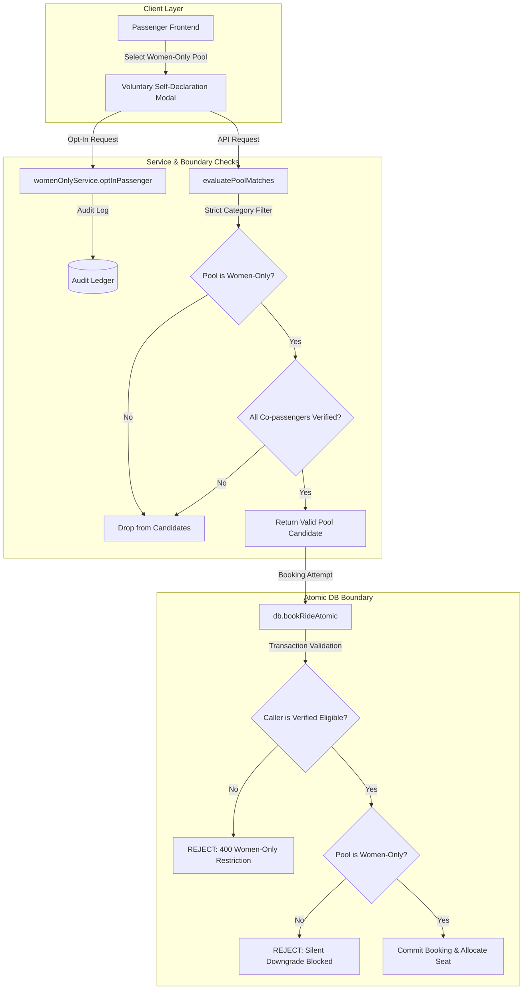

# AeroPool — Women's-Only Pool: Security & Privacy Audit

**Date:** November 8, 2026  
**Auditor:** Senior Geospatial Frontend & Platform Security Architecture  
**Scope:** Server-Side Eligibility, Anti-Tampering, Privacy Safeguards, Role-Based Access Control, and Transaction Integrity

---

## 1. Security Architecture & Threat Model

The Women's-Only Pool feature is designed as a secure, privacy-first option for women travelling from the airport who prefer sharing a vehicle exclusively with verified women passengers. The threat model addresses five primary risk vectors:



---

## 2. Server-Side Enforcement (Defense-in-Depth)

Security is not reliant on client-side state or UI hiding. Multiple independent verification barriers exist:

### Barrier 1: Matching Engine Filter (`src/services/matchingEngine.ts`)
* In `evaluatePoolMatches()`, if `request.rideType === 'WOMEN_ONLY_POOL'`:
  - The pool candidate must satisfy `pool.isWomenOnlyPool === true`.
  - The requesting passenger must satisfy `isPassengerEligible()`.
  - Every existing passenger currently in the pool must have `isWomenOnlyEligible === true`. If even one passenger is unverified or male, the pool is immediately skipped.
* Conversely, standard shared pool requests (`SHARED_POOL`) explicitly skip any pool marked with `isWomenOnlyPool === true`.

### Barrier 2: Database Transaction Guard (`src/services/db.ts:bookRideAtomic`)
* Even if an attacker crafts a raw HTTP/RPC request targeting a Women-Only pool ID:
  ```typescript
  if (pool.isWomenOnlyPool) {
    const isEligible = Boolean(
      params.isWomenOnlyEligible ||
      womenOnlyService.isPassengerEligible(params.passengerId)
    );
    if (!isEligible) {
      return {
        success: false,
        error: 'Women-Only Pool restriction: Only verified women passengers can book seats in this pool.',
      };
    }
  }
  ```
* Any booking without verifiable eligibility is rejected with an explicit error, preventing race conditions and unauthorized seat acquisition.

### Barrier 3: Anti-Silent Downgrade Guard (`src/services/db.ts`)
* If a passenger books with `rideType === 'WOMEN_ONLY_POOL'`, the database rejects matching into a standard pool (`!pool.isWomenOnlyPool`):
  ```typescript
  if (params.rideType === 'WOMEN_ONLY_POOL' && !pool.isWomenOnlyPool) {
    return {
      success: false,
      error: 'Security constraint: Women-Only Pool requests cannot be placed into standard mixed pools without explicit passenger opt-in.',
    };
  }
  ```
* Under no circumstances is a passenger silently placed into a mixed-gender vehicle when no Women-Only pool is available.

---

## 3. Privacy, Data Minimization & Legal Alignment

### Zero Inference Policy
* **No Algorithmic Gender Guessing:** The platform strictly prohibits inferring a user's gender from names, profile pictures, social media profiles, or facial analysis algorithms (avoiding algorithmic bias and privacy infringement).
* **Voluntary Opt-In:** Passenger eligibility is based strictly on voluntary self-identification confirmed through a dedicated opt-in modal (`womenOnlySelfDeclaration`).
* **Identity Protection:** Co-passengers never see other flyers' verification records, national IDs, or medical/gender disclosures. Only first name and assigned pickup zone are visible for boarding coordination.

### Data Minimization
* Only the boolean eligibility flag (`isWomenOnlyEligible`) and verification status (`verified`, `pending`, `revoked`) are persisted.
* No extraneous biometric or identity documents are collected or stored for this feature.
* Sensitive identity records are accessible exclusively to Super Admins via `AdminDashboardView.tsx`.

---

## 4. Driver & Fleet Verification Rules

* **Commercial Fleet Integrity:** All drivers assigned to pools (including Women-Only pools) must be verified commercial drivers with approved background checks, valid police verification certificates, and registered commercial permits.
* **Auto-Assignment Safety:** Driver assignment strictly selects drivers where `verificationStatus === 'approved'` and `isAvailable === true`.
* **Zero Driver Exclusion Gaps:** In line with Indian commercial transport regulations, commercial taxi operators maintain approved background clearances. The vehicle itself is tagged as an authorized Women-Only pooled trip during the active transit window.

---

## 5. Audit Logging & Administrative Oversight

All administrative updates and user opt-ins generate immutable audit log entries:
1. **User Opt-In:** `WOMEN_ONLY_PASSENGER_OPT_IN` logged with user ID, name, and timestamp.
2. **Admin Status Change:** `WOMEN_ONLY_STATUS_UPDATED` logged with actor role, prior state, and new state.
3. **Verification Approval/Revocation:** `WOMEN_ONLY_VERIFICATION_STATUS_CHANGED` logged with review decision and admin ID.

Audit records are persisted to the system ledger via `db.createAuditLog()` and reviewed in the Super Admin dashboard.
